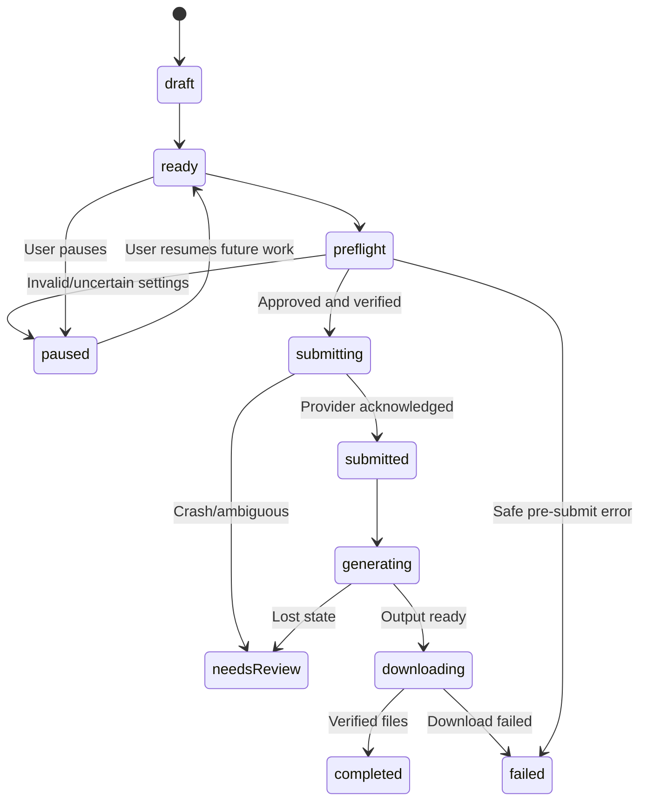

# Domain data model (planning contract)

## Entities

| Entity | Essential fields | Constraints |
|---|---|---|
| `Job` | id, provider, kind, prompt, targetRef, settingsSnapshot, status, createdAt, updatedAt | Immutable id; validate model/mode combinations |
| `JobAttempt` | id, jobId, stage, preflightSnapshot, approvedCredits, submittedAt?, acknowledgedAt?, reconciliationState | One active attempt; no blind replay after submit uncertainty |
| `JobEvent` | id, jobId, attemptId, time, type, sanitizedMessage, code | Append-only; no secrets; stable ordering |
| `MediaAsset` | id, jobId, provider, model, kind, sourceTileId?, downloadId?, localFilename?, mediaMetadata, status | Completed only after verified download; absent file marked missing |
| `Preset` | id, name, provider, model, ratio, duration?, resolution?, outputCount, revision | Validate against fresh capability matrix |
| `CapabilitySnapshot` | provider, observedAt, accountScopeHash?, supportedCombinations, sourceLabel | Account marker must not identify/track user's real Google ID |
| `PriceSnapshot` | sourceUrl, observedAt, model, duration, resolution, planTier?, credits, confidence | Unknown/stale != 0; check UI before paid batch |
| `Approval` | jobGroupId, exactSettingsHash, outputCount, estimatedCredits, approvedAt | Settings drift invalidates approval |
| `ProjectPreference` | target provider project, download relative folder, theme, notifications | Storage local, no password or Google OAuth token |

## Job lifecycle

The actual stored enum can use `needs-review` while code uses `needsReview`; choose one serialized representation and test migrations.

## Migration rules

- Version every IndexedDB store and settings envelope.
- Back up/validate old records before migration; no silent deletion on schema errors.
- Never equate corrupted status to `ready`: safe default is `needs-review` or non-runnable `failed`.
- Artifact integrity references can be checked by `downloadId` or optional hash, but local Downloads files may be moved externally.

## Privacy

Store only job data user typed or explicitly selected, plus necessary provider project metadata. Redact raw prompts, PII and signed media URLs from exported diagnostic logs by default. The browser should not sync detailed job history to cloud automatically.
