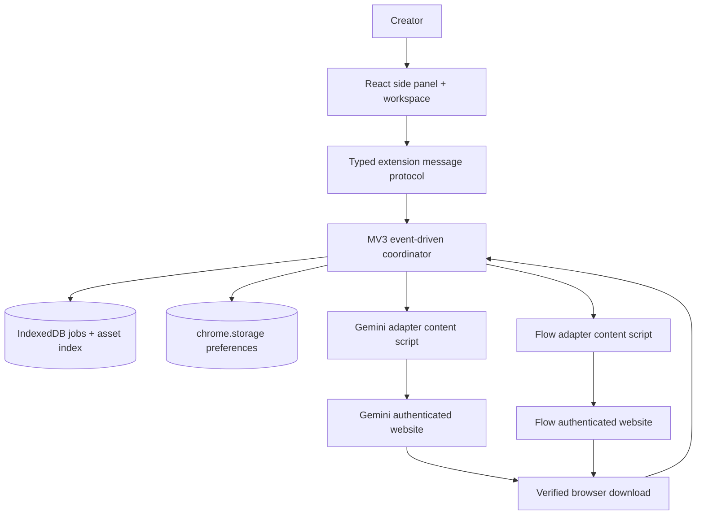

# System architecture and technical boundaries

## Proposed modules



## Runtime separation

- **Trusted extension UI:** React pages show job settings, model catalog, queue, library and actual state. UI does not directly mutate third-party page DOM.
- **Service worker:** Registers event listeners synchronously/top-level; routes typed commands, coordinates jobs and browser downloads; can be terminated at any time.
- **Adapters:** Domain-scoped content scripts look at visible website UI, apply controls, read visible state, and report structured results. Never export site credentials, hidden access tokens or security challenge solutions.
- **Persistence:** `chrome.storage.local` for small preferences and migration marker; `IndexedDB` for durable job/attempt/event/asset records. No raw media in IndexedDB by default (unless bounded previews and cache cleanup policy approved).
- **Download manager:** Uses Chrome `downloads` with safe relative subpaths; correlates download IDs and checks completion.
- **Optional external automation:** Deliberately excluded from V1; no local daemon, REST service, headless private API bridge, paid API key or Docker requirement.

## Key interfaces (contracts, not implementation)

```ts
type Provider = 'gemini' | 'flow';
type MediaKind = 'image' | 'video';
type JobStatus =
  | 'draft' | 'ready' | 'preflight' | 'submitting'
  | 'submitted' | 'generating' | 'downloading'
  | 'completed' | 'failed' | 'paused' | 'needs-review';
interface CapabilityResult { available: boolean; reason?: string; observedAt: string; }
interface ProviderAdapter {
  identifyTarget(): Promise<CapabilityResult>;
  readCapabilities(): Promise<unknown>;
  validateSettings(settings: unknown): Promise<CapabilityResult>;
  submitOnce(attemptId: string): Promise<unknown>;
  reconcileAttempt(attemptId: string): Promise<unknown>;
}
```

## Submission algorithm invariants

1. Require authenticated visible provider tab and one pinned target chat/project.
2. Read current website capability and effective settings; validate against job snapshot.
3. Calculate estimated spend, verify approval token bound to settings and output count.
4. Persist attempt `submitting` **before** clicking Generate; acquire tab/project lock.
5. Click the visible Generate UI once, then persist acknowledgement if observed.
6. If worker/tab dies across the click boundary, mark `needs-review` and reconcile manually/with positive provider evidence. Never automatically replay ambiguous submission.
7. On positive completion, start downloads; `completed` only after verified files/explicitly labeled partial outcomes.

## MV3 lifecycle assumptions

Chrome service workers can terminate during idle. Do **not** rely on a 10-minute `setTimeout` in a service worker or attempt to keep it alive permanently. Use `chrome.alarms`, events, persisted state, and page-observed state for long jobs. A content script's availability and the provider tab remaining open are not guaranteed.

Official documentation: https://developer.chrome.com/docs/extensions/develop/concepts/service-workers/lifecycle

## Security boundaries

- **Allowed origins** must be listed narrowly and revisited before shipping.
- Pass only whitelisted structured messages between UI/service worker/content scripts.
- DOM is untrusted input, even on Google pages; sanitize text, HTML and file names.
- The extension should not request `debugger` or broad all-sites permissions by default. If feasibility requires high-privilege mechanisms, stop and get a separate architecture/security decision instead of quietly adding them.
- No CAPTCHA/challenge automation, token interception, request-signature extraction or undocumented provider API calls.
